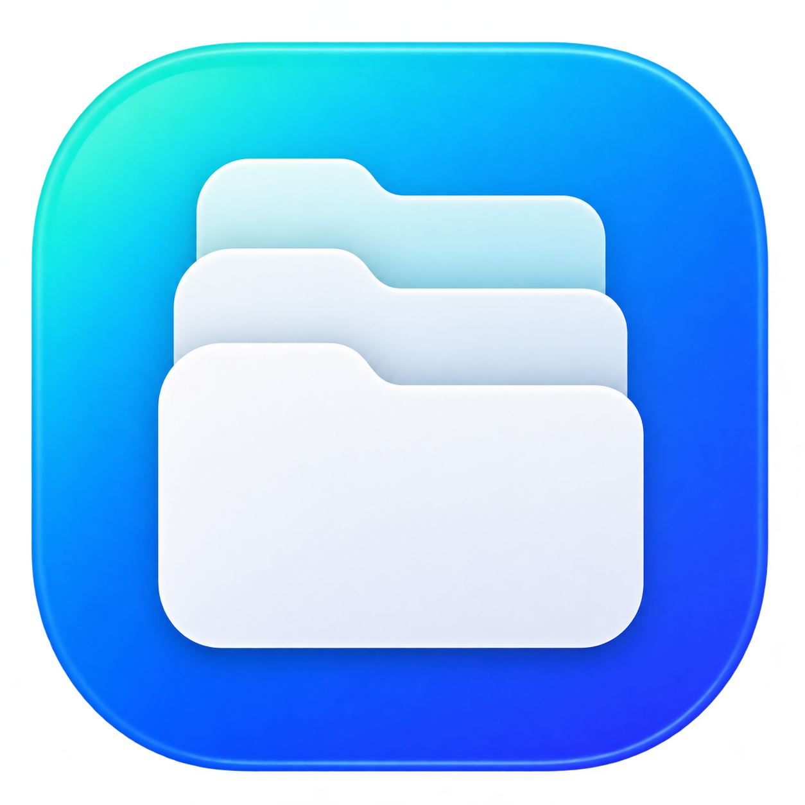

<p align="center"></p>

# Foldy

Son açtığınız Finder klasörlerine menü çubuğundan ulaşın ve sık kullandıklarınızı sabitleyin.

**[Foldy 0.5.1 DMG indir](https://github.com/wearebrandpeople/Foldy/releases/download/v0.5.1/Foldy-0.5.1-Universal.dmg)**

macOS 13 veya üzeri. **Universal:** Apple Silicon ve Intel Mac.

## Kurulum

1. DMG dosyasını açın.
2. **Foldy** uygulamasını **Applications / Uygulamalar** klasörüne sürükleyin.
3. Foldy’yi açın; menü çubuğundaki üç klasör simgesini kullanın.
4. Finder’da bir klasör açın. macOS sorarsa Foldy’nin Finder’ı kontrol etmesine izin verin. Bu izin açık klasörün yolunu okuyabilmesi için gereklidir.

İzin daha önce reddedildiyse Sistem Ayarları > Gizlilik ve Güvenlik > Otomasyon > Foldy > Finder bölümünden açabilirsiniz.

Önceki Klasör Panosu/Foldy sürümünü kapatıp güncelleyin. Geçmiş ve sabitlemeler korunur; eski Klasör Panosu uygulama kopyasını kaldırabilirsiniz.

## Özellikler

- Son 100 klasör, ad/yol araması ve tek tıkla açma.
- Kalıcı sabitleme; sabitleme düğmesi satır üzerine gelince görünür.
- Yerel yatay kaydırma ile tek tek geçmiş kaydı silme.
- Renkli uygulama simgesi ve macOS görünümüne uyarlanan tek renk menü simgesi.
- Normal kullanımda gereksiz Finder bilgilendirme satırı gösterilmez; izin/hata mesajları korunur.
- Oturum açılışında başlatma desteği.

Otomatik başlangıcı etkinleştirmek için:

```sh
'/Applications/Foldy.app/Contents/MacOS/Foldy' --enable-login
```

Başlangıç kaydı Sistem Ayarları > Genel > Giriş Öğeleri bölümünden yönetilebilir.

## Gizlilik

Klasör geçmişi ve sabitlemeler yalnızca bilgisayarınızda, `~/Library/Application Support/KlasorPanosu/history.json` dosyasında saklanır. Uygulama bu bilgileri göndermez. Uyumluluk için veri klasörünün eski adı korunmuştur. Kullanıcı geçmişi, özel klasör yolları, sertifika ve anahtarlar bu depoya dahil değildir.

Finder öndeyken etkin pencere 1,5 saniyede bir okunur; çok hızlı geçilen klasörler atlanabilir. Geçmişe dönük ziyaretler alınmaz. Fiziksel klasör olmayan arama görünümleri kaydedilmeyebilir.

## Kaynaktan derleme

Xcode Command Line Tools gerekir:

```sh
bash build.sh
open Foldy.app
```

Derleme her iki mimariyi üretir, Universal uygulamada birleştirir ve geçmiş modeli testlerini çalıştırır. Yerel derleme ad-hoc imzalıdır. GitHub sürümündeki DMG, Developer ID ile imzalanmış ve Apple notarizasyonundan geçirilmiştir.

Universal ikili her iki mimariyi içerir; canlı çalıştırma Apple Silicon üzerinde doğrulanmıştır. Intel donanımda ayrıca test edilmemiştir.
